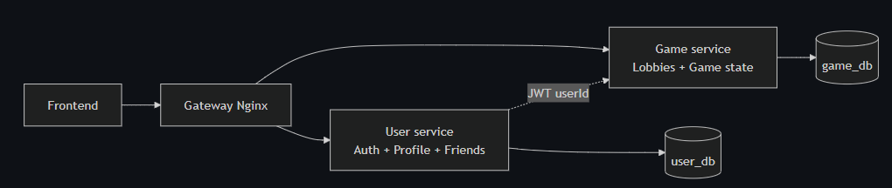

*This project has been created as part of the 42 curriculum by amulet, bfaechti, emiloud, ugwentzi and vvalenti*

# ft_transcendence — Bomber'team

## Description

**Bomber'team** is a real-time multiplayer web platform built around a classic Bomberman game, developed as part of the ft_transcendence project at 42. Players can create an account, customize their profile, add friends, chat, compete in matches (local and remote), track their stats, and climb a global leaderboard.

**Key features:**
- Secure authentication with two-factor authentication (SMTP)
- Real-time multiplayer Bomberman matches (local and remote players)
- Profile management with avatar upload, stats, and achievements
- Friends system (search, add, accept/decline requests, remove, see their profile)
- Real-time chat
- Global leaderboard ranked by XP
- Multi-language support (English, French, Spanish)
- Responsive UI

## Instructions

### Prerequisites

- [Docker](https://docs.docker.com/get-docker/) and Docker Compose
- A `.env` file at the project root (see `.env.example` for required variables: database credentials, JWT secrets, `TOTP_ENCRYPTION_KEY`, Google OAuth credentials, service ports, etc.)?

### Running the project

```bash
git clone <repository-url>
cd ft_transcendence
cp .env.example .env   # fill in the required secrets
make                    # or: docker compose up --build
```

The application is then available at :
- `https://localhost:8443` *(local)*
- `https://<hostname>:8443` *(remote)*

### Stopping / cleaning

```bash
make down				# stop containers
make fclean				# stop and remove containers, volumes, images
```

## Team Information

| Login | Role(s) | Responsibilities |
|---|---|---|
| `vvalenti` | Project Owner / Fullstack Developer | Frontend connexions with backend, chat UI, front API and services, game logic support, legal pages |
| `ugwentzi` | Tech Lead / Backend / DevOps | Docker, nginx gateway, deployment, infrastructure, game canvas/rendering |
| `emiloud` | Project Manager / Frontend Developer | Project coordination, UI/UX, design system, i18n, frontend features, UI components |
| `bfaechti` | Backend Developer | Auth-service, user-service, database schema, gamification  |
| `amulet` | Backend Developer | Game service, WebSocket gateway, game logic, gamification |


## Project Management

- **Work organization:** The project was split into 4 phases, with tasks broken down per feature and assigned by role (frontend/backend).
- **Meetings:** Weekly sync meetings to review progress and unblock issues. And at the end of each phase to test the project, validate the phase and give task for the next one.
- **Tools:** GitHub / Notion / google Docs.
- **Communication:** Discord.
- Each new feature followed the same pattern: data types defined first, then a backend endpoint, then a frontend service layer (with mocks used during parallel development so frontend wasn't blocked on backend), then the UI component itself.

## Technical Stack

### Frontend
- **React 19** with **TypeScript**, bundled with **Vite**
- **Tailwind CSS 4** for styling
- **react-router-dom** for routing
- **react-i18next** for internationalization (English, French, Spanish)
- **socket.io-client** for real-time communication (game, presence, chat)
- **Phaser** for the Bomber'team game engine/rendering

### Backend
- **NestJS** (Node.js/TypeScript), split into microservices (user-service, game-service, socket-service)
- **Prisma ORM** with a relational database (PostgreSQL)
- **JWT** (access + refresh tokens) for authentication, with TOTP-based two-factor authentication
- **bcrypt** for password hashing
- **Multer** for avatar file uploads

### Infrastructure
- **Docker Compose** to orchestrate all services with a single command
- **nginx** as a reverse proxy / API gateway, routing `/api/auth`, `/api/user`, `/api/game`, and WebSocket traffic (`/socket.io/`, `/game-socket.io/`) to the appropriate backend service, and terminating HTTPS

### Why these choices
- **Microservices** were chosen to cleanly separate user data, and game logic, allowing backend developers to work in parallel without blocking each other.
- **Prisma** was chosen for type-safe database access and straightforward schema migrations.
- **A shared design system** (reusable `Card`, `Button`, `Avatar`, `Badge`, `Dropdown`, `Input`, `Spinner`, `Toast`, `Nav`, `Modal` components) was built early so every feature card (profile, friends, rules, leaderboard) stays visually consistent.

## Database Schema



Core tables/relations:
- **User**: `id`, `username`, `email`, `passwordHash`, `avatarUrl`, `level`, `wins`, `losses`, `xp`, `bombeplaced`, `ennemykill`, `twoFactorEnabled`, `twoFactorCodeHash`, `twoFactorCodeExpiresAt`, `twoFactorCodePurpose`, timestamps
- **Friendship**: `senderId`, `receiverId`, `status` (pending/accepted), timestamps — represents both friend requests and confirmed friendships
- **RefreshToken**: `userId`, `tokenHash`, `expiresAt` — session management
- **Game**: `lobbyPlayer`, `Lobby`

## Features List

| Feature | Description | Contributor(s) |
|---|---|---|
| Authentication (register/login) | Account creation and login with JWT sessions | `bfaechti`, `vvalenti` |
| Two-factor authentication (2FA) | SMTP-based 2FA: QR code setup, enable/disable, verification at login | `bfaechti` |
| Profile management | View and edit profile (username, email, password, avatar), stats (level, wins, losses) | `emiloud`, `bfaechti`, `vvalenti` |
| Avatar upload | Upload and display a custom profile picture | `bfaechti`, `emiloud` |
| Friends system | Search users, send/accept/decline friend requests, remove friends, view friend profiles | `emiloud`, `vvalenti` |
| Real-time presence | Online/offline status shown on profile and friends list | `amulet`, `vvalenti` |
| Chat | Real-time messaging between users | `vvalenti` |
| Leaderboard | Global ranking of players by XP | `emiloud`, `bfaechti` |
| Bomberman game | Local and remote multiplayer matches, server-authoritative game loop | `amulet`, `ugowentzi`, `bfaechti` |
| Multi-language support | UI available in English, French, and Spanish | `emiloud` |
| Rules / controls card | In-app reference for game rules, power-ups, and controls | `emiloud` |

## Modules

Point values below match the subject exactly (Major = 2pts, Minor = 1pt). 

| Category | Module | Type | Points |
|---|---|---|---|
| Web | Use a framework for both the frontend and backend. | Major | 2 |
| Web | Implement real-time features using WebSockets or similar technology. | Major | 2 |
| Web | Allow users to interact with other users.  | Major | 2 |
| Web | Use an ORM (Prisma) | Minor | 1 |
| Web | Custom-made design system | Minor | 1 |
| Accessibility and Internationalization | Multiple languages (EN/FR/ES) | Minor | 1 |
| Accessibility and Internationalization | Support for additional browsers. | Minor | 1 |
| User Management | Standard user management | Major | 2 |
| User Management | Implement remote authentication with OAuth 2.0 (Google) | Minor | 1 |
| User Management | Two-Factor Authentication (2FA) | Minor | 1 |
| Gaming and user experience | Web-based game (Bomberman) | Major | 2 |
| Gaming and user experience | Remote players | Major | 2 |
| Gaming and user experience | Multiplayer game (more than two players) | Major | 2 |
| Gaming and user experience | Game customization options | Minor | 1 |
| Gaming and user experience | A gamification system to reward users for their actions. | Minor | 1 |
| Devops | Backend as microservices | Major | 2 |
| Devops | Health check and status page system with automated backups and disaster recovery procedures | Minor | 1 |

**Total: 25 points**

### Module justifications

**Web-based game — Bomberman (Major, 2pts)**
We built a complete, playable Bomberman game with clear rules (place bombs, destroy blocks, eliminate opponents) and win/loss conditions, rendered on canvas. This is the foundational module every other gaming module in our list depends on.

**Remote players (Major, 2pts)**
Two or more players on separate machines can play the same match in real time over a WebSocket connection, with a server-authoritative game loop to prevent desync and basic cheat resistance. This was chosen because local-only play doesn't reflect how the game is actually meant to be used, and implementing it required handling network latency, state synchronization, and reconnection — a genuinely harder problem than the base game alone.

**User interaction — chat, profile, friends (Major, 2pts)**
Users can view and edit their profile (including avatar upload), add/search/remove friends, accept or decline friend requests, and chat in real time. This was chosen because a game is more engaging with a social layer around it, and it required building a consistent three-layer pattern (API → service → UI) across several interconnected features.

**Standard user management (Major, 2pts)**
Users can register, log in, update their username/email/password, upload a profile picture, and see friends' online status. This is the baseline social/account layer the rest of the platform builds on.

**Backend as microservices (Major, 2pts)**
The backend is split into independent services (auth-service, user-service, game-service, socket-service) behind an nginx API gateway, each with a single responsibility and communicating over REST/WebSocket. This was chosen so backend developers could work in parallel without blocking each other, and so each service could be scaled, deployed, or restarted independently.

**Use an ORM — Prisma (Minor, 1pt)**
Prisma was used for type-safe database access and schema migrations across the services that need a database, reducing the risk of raw-SQL bugs and keeping the schema itself as a single source of truth.

**Multiple languages (Minor, 1pt)**
The UI is fully translatable and available in English, French, and Spanish via `react-i18next`, with a language switcher accessible from the navigation bar and the chosen language persisted across sessions.

**Two-Factor Authentication (Minor, 1pt)**
Users can enable TOTP-based 2FA (QR code setup via an authenticator app), and login conditionally requires a 6-digit code when enabled. This was chosen to add a real layer of account security beyond password-only login, addressing a genuine risk (credential reuse/theft) rather than being a token feature.

**Custom-made design system (Minor, 1pt)**
A shared set of reusable components (`Card`, `Button`, `Avatar`, `Badge`, `Dropdown`, `Input`, `Spinner`, `Toast`, `ProfileRow`, `Nav`) with a consistent dark color palette and a single pixel-style font (`font-micro-5`) was built early and reused across every feature (profile, friends, rules, leaderboard), keeping the UI visually consistent without duplicating styling logic.

More explanation can be given for the other modules. But to me more global about the project and chosen modules, we wanted to do something logical and practical. The decisions were made together, trying to find the best workflow throughout the project from A to Z, and also for the user/player.

## Individual Contributions

### `vvalenti` (Project Owner)
Responsible for coordinating the overall project development, representing the team during meetings, following the progress of the different project areas.

---
**Phase I — Frontend Architecture & Authentication**

Development of the initial frontend architecture together with @emiloud. Establishment of the main application structure, routing, pages, services, and API communication layer.

Implementation of the main frontend pages and user flows, including the Terms of Service and authentication-related pages. Development of the frontend logic for login and registration, including the API integration with the backend authentication/user services and session management.

---
**Phase II — Friends, Lobby & Chat**

Continued development of the frontend by implementing the user profile and friends systems. Main contribution focused on connecting these features to the backend and establishing the required REST and WebSocket communication.

Implementation of the complete lobby and chat system, including their frontend interface, conexion and realtime synchronization through sockets. 
In collaboration with @Bfaechti on the backend implementation and integration.

Additional work on authentication and session handling to ensure correct account switching, logout behaviour, and isolation between user sessions.

---
**Phase III — Multiplayer Game Integration**

Integration of the frontend game with the backend game-logic service, transitioning the game from a local implementation to a multiplayer architecture.

Implementation and connection of the realtime communication required to synchronize the game state between clients and the authoritative game logic. Integration of multiplayer player states and movements.

### `ugwentzi` (Tech Lead)
Responsible for defining the project's technical architecture, making key technology and infrastructure decisions, maintaining code quality and consistency, and reviewing critical changes.

---

**Phase I — Architecture**

Definition of the microservice architecture and initial Docker Compose structure. Separation of the application into dedicated services for users/authentication, game logic, realtime communication, and frontend, with PostgreSQL databases logically separated by domain. Establishment of the shared configuration and environment-variable structure used by the services.

---

**Phase II — Infrastructure**

Integration of the complete service stack, including the Nginx gateway, service health checks, development and production Docker Compose configurations, and the project Makefile. 

Nginx provides a single entry point and routes HTTP and WebSocket traffic to the appropriate service. Health checks ensure that dependent services start only when required services are ready.

The Makefile provides common commands for building, starting, stopping, monitoring, cleaning, and running the project in development mode.

---

**Phase III & IV — Game Architecture**

Implementation of the multiplayer game architecture.

On the frontend, creation of the game assets/sprites with animations, integration of Phaser and separation of rendering, input, networking, and game logic through dedicated modules such as `GameApi`, `RemoteGameClient`, and entity-specific views. The client consumes authoritative server state and interpolates visual movement for smoother rendering.

On the backend, contribution for the authoritative game loop responsible for movement, players, bombs, maps, explosions, and power-ups.

### `emiloud` (Project Manager)
As Project Manager and Frontend Developer, responsible for coordinating the team's work and task breakdown, maintaining the design system, translations and UI consistency, and building the application's main user-facing features: profile, friends, leaderboard, and in-app documentation (rules/controls).

---

**Project Management**

Breakdown project into 4 concrete phases, ordered tasks and the workflow to follow. Coordination between frontend and backend at each meeting, taking notes to follow up each progress or diffuculties in the project.

---

**Design System**

Design and implementation of the shared, reusable component library used across every feature card: `Card`, `Button`, `Avatar`, `Badge`, `Dropdown`, `Input`, `Spinner`, `Toast`, `ProfileRow`, and `Nav`. Established a consistent dark, pixel-styled visual identity (single display font, shared color/variant system) and a repeatable modal/overlay pattern (`fixed inset-0` + `Card`) reused by every feature built afterward, keeping the UI consistent without duplicating styling decisions.

---

**Profile**

Implementation of the profile card: view/edit modes, username/email/password editing with client-side validation, and avatar upload (including debugging a file-type validation mismatch between the frontend and a NestJS backend validator). Profile data is fetched live from the backend rather than cached locally, so stats stay accurate after gameplay or edits. Added account deletion with a confirmation step.

---

**Friends**

Implementation of the full friends system: friends list with online/offline status, friend profile viewing, search-and-add by username, sending/accepting/declining friend requests, and removing friends, each with toast feedback on success or failure. Built a custom positioning system for the dropdown menu (used for per-friend actions) so it stays visible and correctly placed even inside a scrollable list, without depending on an external UI library.

---

**Leaderboard**

Implementation of a global leaderboard ranked by XP, fetched from the backend and sorted/ranked client-side as a safeguard, reusing the existing `Avatar`/design-system components to match the rest of the application's visual style.

---

**In-app documentation and i18n**

Implementation of the rules/controls card (map legend, base rules, power-ups, keybinds), including responsive layout fixes so it displays correctly on both desktop and mobile. Writing and integration all of the website content in English, French, and Spanish for the i18n system, alongside general responsiveness and layout fixes across the navigation bar and language switcher.

---

**Challenges faced**

Diagnosing cross-service integration issues against a backend built by teammates — mismatched API routes and HTTP methods, a stale-session bug after a database reset (resolved by handling 401 responses to clear local session state), and a NestJS file-upload validator rejecting correctly-typed files (resolved by identifying it as a magic-number validation issue and disabling it with `skipMagicNumbersValidation`). Each issue was isolated by reading the actual network response/error before changing any code, rather than guessing at fixes.

### `amulet` (Developper)
**Phase 1 — Realtime Communication**

Implementation of the realtime communication layer using NestJS and Socket.IO. Creation of dedicated /app, /chat, and /game namespaces with JWT-based WebSocket authentication, room management, user presence, chat communication, game events, and graceful connection/disconnection handling.

Centralization of WebSocket events through shared constants and separation of the communication layer into dedicated gateways, guards, and services.

---

**Phase 2 — Game Logic**

Implementation of the authoritative multiplayer game logic on the backend. Management of the game state, player movements, map and block generation, bombs and explosions, destructible blocks, and power-ups.

The backend validates player actions and maintains the authoritative state of each game before broadcasting updates to the connected clients.

---

**Phase 3 & 4 — Gamification**

Integration of gameplay statistics into the backend gamification system. Collection of statistics such as bombs placed, blocks destroyed, and kills during each game, followed by their conversion into experience points.

The resulting XP and gameplay statistics are transmitted to the user/profile system, allowing actions performed during matches to contribute to player progression.

### `bfaechti` (Developper)
**Phase 1 – Database Architecture and Prisma ORM**

- Set up and initialized the global Prisma ORM schema used across the project.
- Designed and implemented the initial database structure for both the game-service and user-service.
- Defined the required models, relationships, and database constraints to support the different services.
- Continuously updated and extended the database schemas throughout the project as new features and requirements were introduced.

---

**Phase 2 – User Service and Authentication**

- Implemented the backend logic for user registration and login within the user and authentication services.
- Developed an email-based two-factor authentication (2FA) system to add an additional layer of security to the authentication process.
- Integrated Google Authentication, allowing users to sign in using their Google accounts.
- Implemented the necessary backend logic and authentication flows to securely manage user credentials, sessions, and authentication methods.

---

**Phase 3 & 4 – Refactoring and Supporting Features**

- Refactored and improved the existing two-factor authentication and Google Authentication systems, with a focus on improving code organization, maintainability, and reliability.
- Developed the backend support required to connect the application to the leaderboard system and handle leaderboard-related data.
- Contributed to the game-service, including the implementation and integration of the bomb explosion module and its associated game logic.
- Implemented an in-game statistics increment system to track and update player statistics based on their actions and game events.
- Continued improving and adapting the backend architecture to ensure that the different services could communicate effectively as the project evolved.


## Resources

- [NestJS documentation](https://docs.nestjs.com/)
- [Prisma documentation](https://www.prisma.io/docs)
- [React documentation](https://react.dev/)
- [react-i18next documentation](https://react.i18next.com/)
- [tailwind css documentation](https://tailwindcss.com/docs/installation/using-vite)
- [Socket.IO documentation](https://socket.io/docs/v4/)
- [otplib (TOTP) documentation](https://developer.mozilla.org/en-US/docs/Glossary/SMTP)
- [phaser documentation](https://docs.phaser.io/)
- [MDN Web Docs](https://developer.mozilla.org/) — general web platform reference

**How AI was used:**
AI (Claude / ChatGPT) was used throughout the frontend development process as a learning and debugging aid, not as a code-generation shortcut. Specifically, it was used to:
- Walk through building React components (profile, friends, leaderboard, rules cards) incrementally, with explanations of each concept (React hooks, `useEffect`, TypeScript generics, async/await) rather than finished code, so the implementation was understood rather than copy-pasted.
- Debug real issues (CSS layout bugs, state management bugs, dropdown positioning, scroll/overflow conflicts) by reasoning through the cause before applying a fix.
- Diagnose integration issues between frontend and a backend built by teammates (mismatched API routes, a NestJS `FileTypeValidator` bug, stale-session handling after a database reset) by cross-referencing frontend error messages against the real backend code.
- Draft translated (English/French/Spanish) in-app text content (game rules) for the i18n files.
- Structure this README according to the subject's requirements.

All AI-assisted code was reviewed, tested, and understood by the author before being committed.

## License

This project was created for educational purposes as part of the 42 school curriculum.
