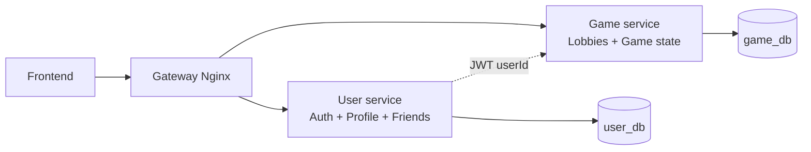
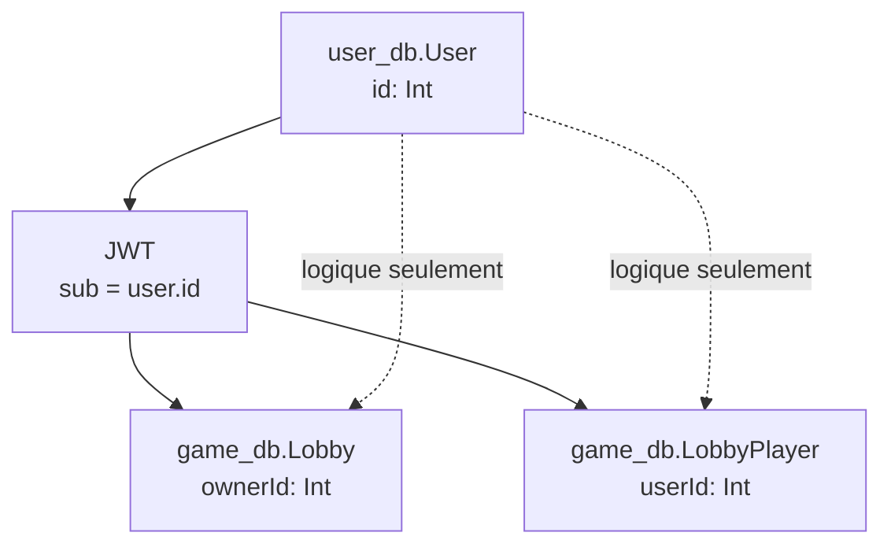

# Schémas des bases de données

## Architecture actuelle

Le projet utilise actuellement deux bases PostgreSQL gérées par Prisma :

- `user_db` : utilisée par `user-service` pour l'authentification, les profils et les amis.
- `game_db` : utilisée par `game-service` pour les lobbies et les joueurs de lobby.

Il n'y a pas de base `auth_db` active dans l'implémentation actuelle. L'authentification est intégrée au `user-service`.



La relation entre les deux services passe par l'identifiant utilisateur contenu dans le JWT. Elle n'est pas une clé étrangère PostgreSQL, car les tables sont dans deux bases différentes.

## User service : `user_db`

Le `user-service` regroupe les responsabilités qui pourraient historiquement être séparées en `auth-service` et `user-service`.

```mermaid
erDiagram
    USER ||--o| REFRESH_TOKEN : "possède"
    USER ||--o{ FRIENDSHIP : "envoie"
    USER ||--o{ FRIENDSHIP : "reçoit"

    USER {
        int id PK
        string email UK
        string username UK
        string passwordHash
        string avatarUrl
        string bio
        int level
        int xp
        int wins
        int losses
        boolean twoFactorEnabled
        string twoFactorCodeHash
        datetime twoFactorCodeExpiresAt
        string twoFactorCodePurpose
        datetime createdAt
        datetime updatedAt
    }

    REFRESH_TOKEN {
        int id PK
        int userId FK_UK
        string tokenHash UK
        datetime expiresAt
        datetime createdAt
        datetime updatedAt
    }

    FRIENDSHIP {
        int id PK
        int senderId FK
        int receiverId FK
        FriendshipStatus status
        datetime createdAt
        datetime updatedAt
    }
```

### Tables et responsabilités

| Table | Rôle |
| --- | --- |
| `User` | Identité, mot de passe hashé, profil, statistiques et état 2FA par email. |
| `RefreshToken` | Session longue durée associée à un utilisateur. Un utilisateur possède au maximum un refresh token grâce à `userId @unique`. |
| `Friendship` | Demandes et relations d'amitié entre deux utilisateurs. |

### Contraintes importantes

- `User.email` et `User.username` sont uniques.
- `RefreshToken.userId` est unique et supprimé avec son utilisateur.
- Une paire `(senderId, receiverId)` ne peut exister qu'une seule fois.
- Le statut d'une amitié vaut `PENDING`, `ACCEPTED` ou `DECLINED`.
- Le code 2FA est stocké uniquement sous forme de hash et possède une date d'expiration.

## Authentification dans le user service

Il n'y a pas de tables séparées `auth_db` dans le schéma Prisma actif. Les données d'authentification sont réparties ainsi :

```mermaid
erDiagram
    USER ||--o| REFRESH_TOKEN : "session"
    USER {
        int id PK
        string email UK
        string username UK
        string passwordHash
        boolean twoFactorEnabled
        string twoFactorCodeHash
        datetime twoFactorCodeExpiresAt
        string twoFactorCodePurpose
    }

    REFRESH_TOKEN {
        int id PK
        int userId FK_UK
        string tokenHash UK
        datetime expiresAt
    }
```

- Login avec email/username et mot de passe : vérification de `User.passwordHash`.
- 2FA active : génération d'un code temporaire, stockage de son hash dans `User`, puis envoi par email.
- Validation 2FA : consommation du code et création de la session.
- Session : stockage d'un hash de refresh token dans `RefreshToken`.

## Game service : `game_db`

```mermaid
erDiagram
    LOBBY ||--o{ LOBBY_PLAYER : "contient"

    LOBBY {
        string id PK
        string name
        int ownerId REF_USER
        boolean isPrivate
        string code UK
        LobbyStatus status
        int maxPlayers
        datetime createdAt
    }

    LOBBY_PLAYER {
        int id PK
        string lobbyId FK
        int userId REF_USER
        string username
        string color
        boolean ready
        datetime joinedAt
    }
```

### Tables et responsabilités

| Table | Rôle |
| --- | --- |
| `Lobby` | Salon de jeu, son propriétaire, son code éventuel et son état. |
| `LobbyPlayer` | Participation d'un utilisateur à un lobby, avec couleur et état `ready`. |

### Contraintes importantes

- `Lobby.id` est un UUID.
- `Lobby.code` est unique lorsqu'il est renseigné.
- Un lobby peut être `WAITING` ou `IN_GAME`.
- Un même utilisateur ne peut apparaître qu'une fois dans un lobby grâce à `(lobbyId, userId) @unique`.
- La suppression d'un lobby supprime ses `LobbyPlayer` grâce à `onDelete: Cascade`.
- `Lobby.ownerId` et `LobbyPlayer.userId` référencent logiquement `user_db.User.id`, mais aucune contrainte SQL inter-base n'est créée.

## Relations inter-services



Les champs `ownerId` et `userId` dans `game_db` ne doivent pas être confondus avec des relations Prisma vers `user_db`. Le game service fait confiance à l'identité portée par le JWT et conserve aussi le `username` dans `LobbyPlayer` comme snapshot d'affichage.

## Ancien fichier `database.sql`

Le fichier racine `database.sql` décrit un ancien modèle avec `users`, `friend`, `messaging` et `party`. Ces tables ne correspondent pas aux schémas Prisma actuellement utilisés par `user-service` et `game-service`. Pour la documentation et les migrations actuelles, les fichiers de référence sont :

- `backend/user-service/prisma/schema.prisma`
- `backend/game-service/prisma/schema.prisma`
